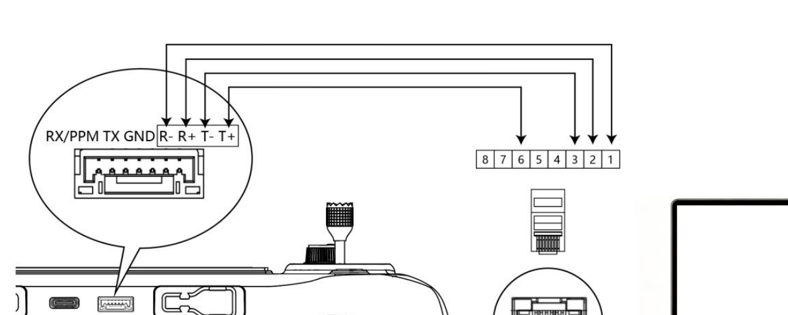

# G11 stock Linux platform, radio and connectors

[Devices](README.md) · [G11 overview](skydroid-g11.md)

## Captured firmware

The initial October 22 investigation examined firmware 1.1.2, build
`20260714 15:57:53`, identifier `7fadb2f91`. Runtime inspection, target-hash-checked
ELFs, HAL SDK documentation and a newer SDK snapshot were distinct sources.
The SDK snapshot was commit `b3917ed3c3a0eef0afc6548ba6a00cffc61d2293`, dated
August 26, with release notes for 1.1.5. Its app/HAL hashes differed from the
installed binaries. Source behavior from that snapshot is not automatically
installed behavior.

The device is a vendor embedded Linux system, not an identified Debian,
Ubuntu, OpenWrt or particular Buildroot release. Generic startup comments and
build-path names do not identify a distribution or exact chip package.

| Item | Captured observation |
| --- | --- |
| Device tree | `INFINITY2M SSC011A-S01A-S`, compatible `sstar,infinity2m` |
| CPU | Two Cortex-A7 cores: implementer `0x41`, part `0xc07`, revision 5 |
| Kernel | 4.9.84, SMP PREEMPT, reported build #11, July 3 2026 |
| ABI | 32-bit little-endian ARM EABI5 hard-float; `ld-linux-armhf.so.3` |
| Runtime | glibc 2.28, libstdc++ 6.0.25, BusyBox 1.20.2 |
| Linux memory | `MemTotal: 71824 kB`; not total physical DRAM |
| Boot reservations | `LX_MEM=0x7f00000`, 48 MiB multimedia heap, 3 MiB framebuffer reservation |
| Published capacity | Manual states 128 MB RAM and 128 MB storage; physical parts not inspected in this study |
| Storage | NAND/UBI/UBIFS; writable root and separate `/config`, `/customer`, `/appconfigs` volumes |
| Temporary mounts | `/tmp`, `/var`, `/vendor` are tmpfs |
| Input devices | Goodix touchscreen on `event0`; no Linux joystick device for the sticks |

Device timestamps often started in January 1970; host-dated records establish
investigation chronology. The `SSD20X_V055` build lineage supports SigmaStar
SDK identification, not an exact package marking.

## Processes and network responsibilities

| Component | Role/boundary |
| --- | --- |
| `app` | Graphical/settings/OSD application owning framebuffer, touch and MCU UART; links HAL, Artosyn client and MAVLink control |
| `Videoplayer` | Independent SigmaStar decode/display process, video-control Unix socket and UDP 554 |
| `daemon -i 3` | Artosyn host RPC server on TCP 50000; `-i 3` selects kernel-driver transport, not UART3 |
| `data_stream` | Radio data bridge, TCP 5760 and UDP 14552 |
| `app.sh` | Restarts named app/radio/video services and repairs the radio interface |
| `wpa_supplicant` / `udhcpc` | Wi-Fi association and DHCP |
| `inetd` / `telnetd` | FTP 21 and Telnet 23 |
| Core/log monitors | Crash handling and log cleanup |

The app also listened on loopback UDP 14551 and UDP 5000. Settings contained
RTSP destinations at air-unit address `192.168.144.108`, ports 554/555. Listener
presence and configured URLs did not establish a working air link. FTP's
visible root was `/tmp/ftp`, so it was not a route to arbitrary device paths.

```text
Controls → MCU ↔ ttyS1 ↔ app / HAL
                         ├─ video-control socket → Videoplayer → decoder/display
                         └─ Artosyn client → daemon → kernel driver → USB AR8030

Ethernet eth0 ─┐
              ├─ br0 192.168.144.110/24 ─ radio network ar_net0
              ┘
Wi-Fi wlan0 ─ separate network; IPv4 forwarding observed disabled
```

The physical stock MCU-to-radio control path was not traced. The installed
app's direct-branch scan found `hal_rc_tuner_get_rudder()` called by its display
refresh thread; indirect calls were outside that scan. The HAL receive worker
delivered synchronous replies and unsolicited `0xcb` status without an observed
radio-forwarding call. The newer SDK's virtual-SBUS setter sent MCU command
`0xd1`. Together these support a candidate MCU-controlled RC route separate
from display polling, not proof of an internal SBUS wire.

One 5.18-second counter window had no `ttyS1` TX increase and 2,701 received
bytes, about 521 bytes/s. That establishes unsolicited traffic, not its payload
identity or control update rate.

## Separate Wi-Fi and Artosyn devices

Wi-Fi enumerated as SDIO `1ffe:6621`, with `skw_sdio`, `skw_sdio_lite`,
`swt6621s_wifi` and `skwbt`; sysfs named `sv6621s_wireless`, and logs named
SKWIFI6621S. This is separate from the internal USB radio. Package markings
were not visually confirmed in the system inventory.

The internal USB radio enumerated vendor/product `1d6b:8030`, manufacturer
Artosyn, product “Artosyn in HS Mode”, at 480 Mbit/s, bound to `artosyn_drv`
0.2.0.12. The driver description, aliases, client library and daemon identify
an AR8030-family implementation, not a silicon stepping or microscope-level
part identification. Unrelated externally connected devices from earlier
experiments are not substitutes for this internal enumeration.

The stock `init_401D()` sequence resets GPIO11, loads the driver, starts the
daemon, creates `ar_net0` and bridges Ethernet. Its name does not certify a
physical 401D module SKU. Network setup used radio slot 0/port 3 with 110,000-byte
TX/RX buffers; another observed socket used slot 0/port 1. These radio ports
are not Linux TCP/UDP port numbers.

A bounded read-only HAL diagnostic created its own daemon RPC connection
without opening the MCU UART or changing RF. The existing processes retained
their PIDs. It returned:

| Query | Captured result |
| --- | --- |
| Software / hardware version | `2.1.02-55` / `4.0` |
| Firmware | `2.1.02-60_g_u_batch_pair_g11_2` |
| Compile timestamp | `05/22/2026 23:55:59`, as reported |
| RF enabled / pair status | 1 / 0; no connected peer per SDK |
| Band mode / working-band code | 1 (automatic) / 2 (full code mapping unresolved) |
| Channel | Index 29 of 32 entries; raw 5800000 → 5800 MHz |
| Power | Getter failed with −1; partial result invalid |

Installed UI code indexed the frequency list and divided by 1000 for MHz.
Reported list ranges included 2400000–2477000 and 5110000–5840000. These are
settings, not spectrum measurements or proof all channels are enabled in every
region. Automatic mode can change the selection. The HAL copied only 32 bytes
of a documented 32-element power array, so the diagnostic reserved the full
structure but did not decode that array. Neither it nor the failed power getter
establishes transmitted power.

At inspection `ar_net0` had no received packets and its air-unit neighbor was
unresolved. A RUNNING virtual interface and RF enabled flag did not prove pairing.

## HAL input ABI and cache limits

Stock `hal_rc_tuner_init()` opens `ttyS1` at 115200 8N1, raw, without flow control,
then starts asynchronous reception. The display getter is synchronous with a
one-second timeout; the refresh worker sleeps 200 ms between polls. Its cache
may persist after the worker stops, so a readable cache and valid flag do not
establish freshness.

| Getter | Command | Installed HAL interpretation |
| --- | --- | --- |
| Channel configuration | `0xa2` | 16 five-byte entries: channel, minimum, middle, maximum, direction |
| Hand mode | `0xa9` | Four-byte integer decoded from MCU flags |
| Coach/trainer | `0xb8` | Mode character plus switch selection |
| Rudder/channel values | `0xb1` | 16 four-byte ABI entries; 16-bit value at entry offset 2 |

The live decoder writes only the value member, not each entry's channel ID.
Use array position with verified configuration rather than zero-initialized
channel members. Configuration endpoints use units of ten; live values already
use values such as 1050/1500 and must not be multiplied again. Direction zero
corresponded to a checked stock UI checkbox. The hand getter writes four bytes
despite a misleading one-byte pointer comment in the header.

SDK physical IDs 1–11 name X1, Y1, X2, Y2, SW1, SW2, H, AUX1, AUX2, B1, B2.
They do not directly imply logical roll/pitch/throttle/yaw order. Coach mode
contains `P`, `M` or `S`; its switch member selects 7/H, 10/B1 or 11/B2. An
abbreviated PDF table confused those fields; source and installed UI agreed.
The later [stock input study](../protocols/g11-stock-inputs.md) records live
mapping and dual-format validation.

A read-only process-memory diagnostic verified the running executable hash
before reading its known cache. Its first sample had refresh inactive and
potentially stale values. Reads were also non-atomic. HAL `data_pool_get()`
accesses process-local storage, not an interprocess channel service; a separate
HAL process would have a separate pool and could compete for UART replies.
The initial inspected pool had only heartbeat valid. The SDK integration hook
compiled/linked against captured libraries but was not integrated into stock
app; build compatibility is not runtime input-export evidence.

## Connector diagram

The manufacturer's G11 manual identifies a GH1.25 seven-contact connector.
The archived excerpt below preserves its orientation. Left-to-right labels
are **RX/PPM, TX, GND, R−, R+, T−, T+**; these are diagram positions, not
manufacturer-assigned pin numbers.



| Handset signal | RJ45 contact shown |
| --- | --- |
| T+ | 1 |
| T− | 2 |
| R+ | 3 |
| R− | 6 |
| RX/PPM, TX, GND | No RJ45 connection shown |

Credit: archived G11 user manual V1.1, Chinese printed page 29/PDF page 30,
English printed page 28/PDF page 73. Its download listing called it V2.0, but
the document itself said V1.1. The diagram shows no module-power pin. The
USB-C charging label alone does not prove absence of USB data lines.

The initial inspection did not verify Ethernet cabling or external UART
ownership. `ttyS2/ttyS3` existed with zero counters; tty numbering does not
establish connector routing. The wireless baud setter controls the remote
peer UART. Later tests physically located custom PB7 output and stock PPM on
RX/PPM; see [dated electrical evidence](../experiments/g11-crsf-electrical.md).
Return-path continuity and loaded CRSF compatibility remain separate questions.

## Application initialization responsibilities

Stock app initializes LVGL, maps the actual framebuffer geometry/stride,
registers touch, loads settings and calls the combined HAL initializer in this
order: MCU UART → Artosyn RPC → backlight PWM → Wi-Fi state. Artosyn connection
retries can take ten one-second delays and fail before backlight initialization.
A replacement must account for that coupling and retain required power/display
behavior, not merely replace drawing code.

The app's status monitor reads MCU state every 100 ms (500 ms after errors)
and coordinates screen/video-display off at POWER_STATE_READY. That is not a
complete Linux shutdown handshake. Boot scripts own multimedia/radio modules,
networking and process supervision; Videoplayer initializes MI_SYS, display,
panel and decoder. A replacement UI should not independently duplicate those
owners. Stock config initialization can write defaults when parsing fails, so
the vendor file is not interchangeable with a custom schema.

The [Linux UI study](../systems/g11-linux-ui.md) covers the later replacement's
rendering, settings and deployment behavior. The direct autonomous MCU design
supersedes the first proposal to put all mixing/calibration on Linux.
