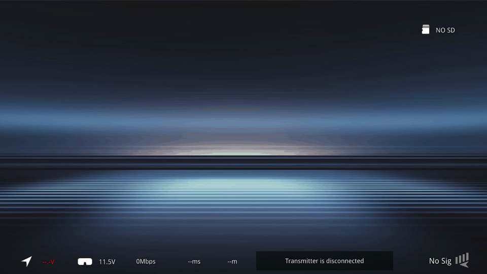
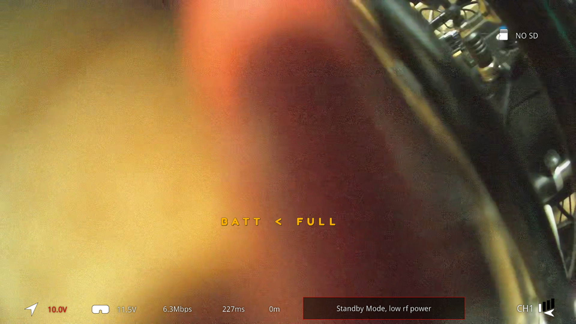

# Open8030 development failure and working-baseline revalidation

[Experiments](README.md) · [Earlier power/recovery trials](ar8030-recovery-and-power.md) ·
[Later AP/DEV release](open8030-validation.md)

Hardware trials 162 and 163 resolve an important boundary in the archived
AR8030 development notes. The final frame-duration implementation did reach
hardware and failed acquisition. Reusing the earlier stage-145 runtime then
restored camera video through the original Gnd485 18.21.10 host stack. This was
a successful baseline revalidation, not a repair of the newer implementation.

The trials were recorded as October 14, 2026 in local research notes. Their
observer timestamps are October 15 at approximately 00:48 and 00:51 UTC,
respectively, consistent with October 14 in Toronto. Older checkpoints saying
“trial 162 unused” describe the state before these experiments.

## Exact runtime comparison

| Item | Trial 162 | Trial 163 |
| --- | --- | --- |
| Implementation | Latest archived frame-duration development | Preserved stage-145 baseline |
| Runtime bytes | 94,068 | 60,592 |
| Runtime SHA-256 | `d3bf5db438fdffc4b01008d8cc98283014804336bcf6aa35e80f79a45ac62e5c` | `f65af4d20c22e5c55273dfe76bb4be01d87b7a8de4e8d4a1392827739daa1bdc` |
| RAM container SHA-256 | `e6638d32b37addbfa5820c8695e032a20f33543de40ebdccb56bd633aadcae45` | `8b816504f0a4612dfc54eba37444579b9871496190f64341ce2df448fe84007f` |
| Allocated RAM in build accounting | 704,512 / 704,512 bytes | 659,888 / 704,512 bytes |
| Native observations | 70 | 70 |
| Observed link states | All disconnected, state 0 | Startup state 0, then linked state 2 |
| Final delivered video bytes | 0 | 24,292,101 |
| Final delivered control bytes | 0 | 154,054 |
| Final endpoint queue/drop counters | Zero | Zero |
| Viewed capture | Disconnected UI | Camera scene with stock overlay |

The stage-145 source was preserved as commit
`c5ec4538e354bc5bf79d0fe04313550a15bb0d98`, tag `stage145-video-verified`.
It had previously been named `ecf45d5` before repository identity cleanup; the
firmware bytes remained unchanged. Its 44,624-byte RAM accounting margin is
distinct from the newer build's zero margin. Neither number establishes actual
worst-case stack use.

Trial 163's package contains the source bootstrap, retained matched configuration
and a runtime padded to 60,928 bytes. Its packaging manifest's
`boot_acceptance_verified: false` records the pre-experiment packaging boundary;
the later hardware receipts provide the separate acceptance evidence. It was a
RAM-load container, not an OTA/NAND image.

## Failure, recovery and baseline activation

Trial 162 successfully initialized the native firmware but never established
the link in its 70 samples. Video and control delivery remained zero. Its
55.019-second capture showed the transmitter-disconnected screen. Successful
offline original-instruction comparisons and the
[frame-duration correction](../firmware/ar8030-command-engine.md) therefore
did not establish normal acquisition or video acceptance.

Automatic restoration completed. The subsequent full stock reboot recorded a
new boot ID, the expected SDIO device and four preserved stock artifact hashes.
The recovery receipt reports 24 successful getter calls and inspected stock
camera output; the retained getter summary reports zero failed getters. These
recovery results are separate from native trial 162's failure.

Trial 163 then loaded the exact older runtime with autonomous native startup;
no private host RF initializer was staged. It restarted the verified original
daemon/backend and GUI after resetting their media-driver allocations. This
validated coexistence with the original executable stack after a controlled
restart, not a radio replacement without interruption to running applications.

Native identity responses bracketed the capture. The final sample was linked
at RX MCS 10. All 70 socket samples satisfied the endpoint accounting relations:
offered bytes equaled accepted bytes, accepted minus delivered equaled queued,
and endpoint drops were zero. Both final queues were empty. These counters are
host delivery accounting; they are not an independent RF packet-loss measure.

The identity text in both runs still included `rf=unsupported`. That stale
diagnostic string distinguishes the native implementation from stock but is
neither an exact runtime hash nor a reliable feature inventory. Package hashes,
boot records, counters and viewed output provide the relevant evidence.

## Captured output

Both recordings contain 1,651 MJPEG frames at 1920×1080, nominal 30 fps. Trial
163 lasts 55.013 seconds. The grabber was MACROSILICON `345f:2130`, serial
`20210621`; historical trial 145 used a different grabber serial and YUYV.

| Trial 162: newer implementation | Trial 163: preserved baseline |
| --- | --- |
|  |  |

These are unchanged retained final-frame images. The working camera scene is
largely obscured and out of focus, so it establishes visible camera delivery
rather than image-quality qualification. Displayed bitrate, latency, standby
and telemetry labels are UI contents; they were not independently calibrated.

FFmpeg stream-copy capture does not provide raw V4L2 sequence/error accounting
or establish the RF camera cadence. The post-activation capture log also contains
an MJPEG missing-EOI warning. The evidence must not be described as a uniformly
error-free raw capture merely because the recordings decode.

## Continued RAM operation and remaining limits

After acceptance, the original experiment deliberately left native firmware
running in RAM. Its acceptance helper checked the observation accounting,
native identity and linked state, then verified the staged candidate hash before
writing a marker. The device script removed its in-test marker and disabled its
exit restoration trap only after seeing that acceptance marker. Without it,
the original exit/fallback restoration remained active.

A later capture still showed the camera scene, and a native sample at
00:54:17 UTC reported 58,394,770 delivered video bytes with no endpoint drops.
The final recorded device state retained stock artifact hashes. No persistent
firmware installation was made; a normal receiver reboot returned to the stock
load path. This is a historical state, not a claim that the device remains
running today or proof of indefinite stability.

The baseline lacked the later dynamic host-power setter. Returning to it did
not fix the stage-145-to-146 acquisition regression or establish the added
channel/automatic-policy work. The cause remained unresolved at this milestone.
The later matched AP/DEV release has its own artifacts and validation scope.

During this wiki review, both retained containers were parsed and their runtime
hashes and zero padding checked. Fourteen files named by the trial-163 receipt
matched their retained sizes/hashes. Both 70-sample observation sets were checked
programmatically, and fresh FFprobe decoding counted 1,651 frames in each
recording without error-level output. The disconnected, baseline and later
post-activation images were inspected. No hardware procedure was rerun.
