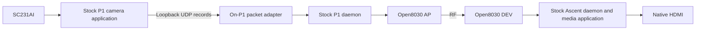
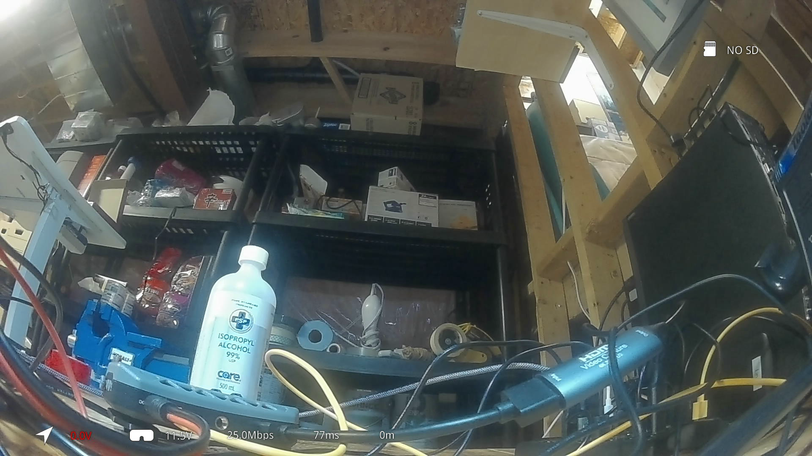

# P1 camera to native Ascent HDMI interoperability

[Experiments](README.md) · [P1 Air](../devices/betafpv-p1-air.md) · [Packet adapter](../protocols/p1-video-adapter.md)

On October 22, 2026, a RAM-only prototype carried the P1's camera video over RF
to the standard Ascent VRX's native decoder and HDMI output. It used the original
P1 1.0.44.rel camera application, original Ascent Gnd485 18.21.10 media/UI stack
and **Open8030 on both radios**. This precedes and differs from the later
[source camera/encoder implementation](p1-source-stack.md).

USB carried management and HDMI capture, not video forwarding between the units.
Camera executables, hardware certificates, identity, RF calibration, flash and
persistent pairing were not patched by this prototype.

## Evidence progression

Early status headings such as “no successful link” and “video not verified”
describe earlier trials and are superseded by the later results:

| Trial | Finding |
| --- | --- |
| 1 | Radio-driver removal deadlocked before the candidate loaded |
| 3–6 | Invalid independent configuration comparisons because firmware-request caching retained earlier inputs |
| 15–16 | Both radios reported connected state 2; receiver recorded 42 and 55 linked samples |
| 17–19 | Camera startup/link instability remained; no stable-video claim |
| 20 | USB control capture recovered 3,562 complete native records, split across two independently decodable HEVC channels |
| 23 | Host-assisted RF test recovered ten exact camera records |
| 26 | On-P1 adapter recovered three exact split-channel records and correct colors; sparse frames were not a synchronized full image |
| 31–32 | Exact byte transport at selected lower MCS/bandwidth settings |
| 34 | 22,884,437 bytes matched; 590 consecutive split frames per channel, synchronized host reconstruction and no FFmpeg errors |
| 35 | 19,467,891 bytes matched; 515 consecutive 1920×1080 frames, normal colors and no FFmpeg errors |
| 36–37 | Native Ascent decoding crashed after userdata allocation errors |
| 39–43 | SEI-filtered adaptation reached native HDMI; trial 43b supplied the final bounded evidence |

The trial-35 full-stream SHA-256 was
`9124c38795775ca28fcd204ffbcc0d9ebfb921f9eedc8e0b43f0c0ecf367ea04`.
The trial-34 split-stream hash was
`9209b47915328e39978c89f517ca7f622ef592adfb401297372950b727e9a7a2`.
Early purple full-frame output did not describe all full-frame operation: the
later cold session produced normal colors.

## Final native-HDMI result

Trial 43b ran the bridge for 25 seconds at 5805 MHz/20 MHz with initial stock
MCS 8, corresponding to internal index 10. It recorded:

- 1,454 consecutive source IDs, 0–1453, with no source-ID gaps;
- 59,514,424 original video-record bytes and zero bridge resynchronization discards;
- a clear full-color 1920×1080 camera image on native HDMI;
- the native receiver backend still alive after the trial.

Receiver SDK3 cumulative offered/accepted/delivered counters each reached
100,774,408 with zero dropped bytes, but included trials 42/43. They are not an
end-to-end hash comparison of trial 43b. The separate SDK0 host captures above
provide byte-exact transport evidence for their own runs.

Recorded trial-43 HDMI still, copied unchanged. The displayed voltage, bitrate,
latency and distance values were not independently validated; the still shows
visible camera output and does not measure motion continuity or latency.

Final package artifact identities included:

| Artifact | SHA-256 |
| --- | --- |
| P1 Open8030 image | `b946c627a5090fbf44e993fd9140efb7aaf35ff4fdbc2fae72565a5605b1b59f` |
| Ascent Open8030 image | `30e45c6aadb16049581f7de3f256781027eff4186b47f4a84814db6117d75c9a` |
| On-P1 adapter executable | `6cb5d4ed7828ec8ebd30e4a6f15f6533316bba1ee2c5e73356f3307c5535390c` |
| Temporary bind shim | `4f71f242cca14794607b8ca2ecb1f0bdc676c4a11b6b7a6545df776c3d771a3c` |

## Radio and loader corrections

The stock P1 radio normally runs DEV role and has a different legacy MAC format.
A volatile idle-scrambler change allowed the receiver to decode packets but did
not fix that MAC incompatibility. The working prototype instead used a P1-specific
Open8030 AP profile, extracted 704 AP defaults and 23 pin records, with I/O-domain
mask 2. The common FCH table was checked against stock P1 firmware.

The stock P1 SDIO driver requires trailer `00 dd length_le16` at the end of a
padded command transfer. The adapted DD command channel worked; CC network data
was rejected in that port, so this was not a completed raw-network radio path.
The Linux driver remained stock. Loader translation mapped power initialization
from the stock manual setting, used numeric AP policy `-1`, and retained P1
calibration rows. The full receiver frequency table made 5805 MHz channel 25.
Radio-side flash identification returned zero, requiring optional factory input
and JSON offsets in this prototype; later P1 calibration work has separate scope.

The driver removal deadlock followed `remove → unregister_netdev → net_close`,
where remove and close acquired the same mutex. Bringing `sdio0` down before
removal avoided that recorded path. Firmware/configuration requests also retained
buffers when filenames were reused: changing only a search directory was not
enough. Distinct content-addressed **image and configuration names** restored
meaningful independent trials.

The receiver JSON forced a manual MCS. Applying a ceiling after association did
not change the already fixed rate; it had to be applied during acquisition.
MCS 6 supported earlier bounded byte tests but bottlenecked longer approximately
20 Mbit/s camera input. The final native-HDMI profile used MCS 8/20 MHz; this is
a bench configuration, not a universal RF-rate recommendation.

## Media and process lifetime

The stock camera backend did not reliably reconnect old sockets after radio
replacement, and process-only restarts could wedge the media allocator. The
working sequence froze stock startup before camera initialization, loaded the
radio first and started the camera once per cold boot. The native camera's
hardware certificate validated against its real OTP identity; no bypass was used.

A temporary bind shim moved only wildcard UDP control binding to the P1's
existing `10.0.0.100` address. The adapter then owned `10.0.0.1:10000/10001` on
loopback. It requested a 4 MiB receive buffer with `SO_RCVBUFFORCE`, because normal
`SO_RCVBUF` was clamped by the stock limit. The dedicated daemon connection had
to begin with socket OPEN; generic RPC initialization first was invalid there.

Socket-write acceptance meant enqueue, not completed RF transmission. The
adapter drained its radio queue before closing; earlier immediate close lost
the tail. Source recording in RAM also exhausted memory in trial 42 before the
filesystem appeared full. Final playback disabled the source capture file.

Native Ascent playback required stripping HEVC prefix/suffix SEI NAL types 39/40.
Offline removal preserved all decoded frame hashes in the 515-frame sample.
The unfiltered native trials crashed `h26x_irq` after userdata-buffer errors;
filtered trials avoided that observed failure. This is a compatibility treatment
for the named decoder stack, not a general claim that SEI is invalid or that
all vendor receivers require its removal.

## Restoration and limits

The bounded peer helper held an exclusive lock through peer/candidate and rate
restoration, including cleanup. Rejected lock/preflight attempts performed no
cleanup setters. It restored the **actual pre-trial runtime configuration**,
which could differ from historical stock pairing. When the old peer was absent,
restored selection did not establish restored RF linkage.

Earlier native decoder faults could block module removal and software reboot;
receiver power cycling was required. Final trial RAM sessions were retained
with the bridge stopped and runtime peer restored. No persistent firmware change
was required. These facts must not be collapsed into a claim that every failed
trial recovered through software.

No flight/range, end-to-end latency, full telemetry/OSD or endurance qualification
was performed. GUI bitrate, voltage and latency readouts were not independently
validated. The later source-camera and NAND work extends the project but does
not retroactively broaden this prototype's measured scope.
