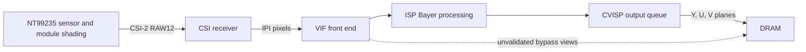

# AR9311 reference NT99235 camera path

[SoC studies](README.md) · [Reference board](../devices/betafpv-vr04-reference.md)

## Scope and topology

The retained reference air-unit study uses an external **NT99235 camera module**
with AR9311/Proxima-9311. It is distinct from the later
[SC231AI P1 camera](ar9311-p1-camera.md). This article consolidates the research
and selected implementation checks at kernel revision
`e3885c6394a7025eacd3a23f473276d9823beb25`; it records no new hardware tests.

| Block | Physical base | Recorded interface |
| --- | --- | --- |
| VIF | `0x08870000`, 64 KiB | GIC SPI 62; input front end and eight bypass views |
| CSI wrapper | `0x08880000`, 64 KiB | SPI 60/61; eight receiver instances in four pairs |
| ISP | `0x08c00000`, 2 MiB | SPI 71; Bayer processing and statistics |
| CVISP | `0x08e00000`, 64 KiB | Output DMA; dedicated completion IRQ remains unmapped |

Each CSI pair occupies `0x1000`: Artosyn wrapper at its base, DesignWare cores
at `+0x400` and `+0x800`. The tested path uses pair 0/core 0, version 1.20.
CVISP is a separate block, absent from the stock device tree; it is not the
scaler at `0x08840000` or GDC at `0x08848000`.

In the studied stock stack, `ar_lowdelay` and `libmpp_service.so` program the
camera through userspace MMIO. The kernel camera power callback reaches an
uninstalled dispatch pointer and returns `-1`. This finding concerns that
firmware configuration, not every Artosyn kernel.

## Sensor control and mode agreement

The module is on I²C0 at address `0x1a`, with 16-bit register addresses and
eight-bit values. Writes are three-byte I²C messages. Sensor registers and SoC
MMIO are separate address spaces. The module performs its own lens shading
before pixels reach the ISP's independent shading stage.

| Library mode | Resolution and rate | CSI lanes |
| --- | --- | --- |
| 0, tested stock mode | 1920×1080 at 60 fps | 2 |
| 1 | 960×540 at 120 fps | 2 |
| 2 | 1920×1080 at 60 fps | 4 |
| 3 | 1280×720 at 90 fps | 4 |

These are recovered mode tables; listing a mode does not qualify its full open
capture path. Register `0x0114` selects two lanes with `1`, four with `3`.
The tested input is RAW12, CSI data type `0x2c`, virtual channel 0.

Reference power-on asserts active-low enable GPIO104 and reset GPIO107, waits
10 ms, enables 24 MHz MCLK, releases reset and waits another 10 ms. Enable stays
asserted. The mode table is followed by a 20 ms settling delay and stream-on
`0x0100=1`. Explicit sensor stream-off uses `0x0100=0` and powers the module down;
I²C comparisons therefore require a live stream. The later CVISP queue lifecycle
deliberately keeps that upstream stream alive between captures.

The two-lane 1080p60 library sequence contains 193 writes. Its registers, values,
duplicates and ordering are retained by the open sequence, with **one extra
write**, `0x0383=1` at position 118. Its likely no-subsampling meaning remains
an interpretation; the sequence is not literally identical.

A post-mode shading callback explains the earlier 26-register mismatch. It
installs a mode-independent static table in `0x8250–0x826d` and
`0x8550–0x855c`, then commits with `0x8201=0x0f`. Replaying it produced zero
differences across 184 compared live registers. This was not AWB drift: the
sensor's AWB callback reports capabilities without writing registers. Comparing
against the four-lane table had also produced a misleading smaller discrepancy.
Register `0x8205`, written as `3`, reads `2` on both stacks.

Exposure is a big-endian line count in `0x0202/0x0203`; gain writes the same code
to `0x0206/0x0207`, under group hold `0x0104`. The open defaults were 1,123 lines
and gain code `0x3c`. The recovered 97-entry gain table follows
`2^(code >> 4) × (16 + (code & 15)) / 16`: `0x3c` is 14× and `0x60` is 64×.
That code is distinct from the exposure-table gain used by ISP adaptation.

The exposure ceiling `frame_length−2` and gain ceiling `0x60` are **driver
clamps**. Requests above them never reach the sensor and do not measure silicon
limits. Likewise, familiar SMIA addresses do not establish SMIA capability
compliance: the module reports ID `0x9235`, revision `0x0b`, but most examined
capability fields are zero or unusable.

## CSI timing and VIF observations

The two-lane mode runs at 900 Mbit/s per lane and uses D-PHY range code 5.
A four-lane 456 Mbit/s configuration maps to code 3; other modes need their own
settling values. Lane count is programmed as `lanes−1` in wrapper and core;
links wider than two lanes merge the paired cores.

Two measured corrections were essential:

- Internal D-PHY registers `0x03` and `0x0a` need `0x03` after frequency setup
  and before deskew for the tested two-lane mode. Without this HS-settle value,
  SoT, double-ECC and frame-boundary errors prevent valid VIF geometry.
- Deskew registers `0x3d` and `0x45` initially receive `0x20`; bit 5 must then
  be cleared. Leaving it set causes clock reacquisition and damaged frame headers.

The corrected path reports zero steady-state CSI error banks on the **second
read**; these banks clear on read. A first read can contain earlier errors.
VIF `+0x1f0=0x0784043c` measures 1924×1084 incoming timing, while configured
active geometry is 1920×1080. A frame-start event alone establishes neither
pixel traversal through ISP nor completed DMA.

VIF debug registers `+0x330–0x33c` contain pairs of 16-bit counters selected by
`+0x32c[19:16]`. Compare captures only with the same selector. Recorded values
with selector word `0x00000fff` included matching 6,640/9,869 fields and another
counter within 0.2%; changing free-running counts are not configuration errors.
The CSI wrapper activity counter has the same interpretive limitation.

The stock handler reads VIF `+0x104/+0x108` for selected error events, and
`+0x10c/+0x110` on the ISP-path frame event. Their exact latch/count semantics
remain unresolved. An earlier blanket claim that `+0x104–0x138` is read-only
is too broad: the recovered CRC configuration routine writes geometry to
`+0x114` or `+0x118`. That CRC path was not exercised by the captured stock run.

The bypass node advertises `RG12`, 1920×1080, stride 3,840 and size 4,147,200
bytes. **No raw bypass frame was delivered in the recorded trials.** Stock
holds the view in reset with `VIF+0x2bc=2` and uses the ISP path instead.
VIF `+0x17c` bit 24 is an ISP-path event, not bypass-view completion. Consequently
there is no raw reference image for a raw-versus-processed comparison.

## CVISP output and buffer lifetime

The captured output setup stages control at `+0x8000` through
`0x00800800 → 0x00800802 → 0x00800806`. Bits 1 and 2 remain unnamed.
Three plane addresses at `+0x8098`, `+0x8174` and `+0x8194` advance together;
the vendor uses five slots. A separate eight-register update occurs once per
ring wrap. Original physical buffer addresses are capture-specific allocations,
not portable constants for another board's allocator.

| Plane | Active dimensions | Stride | Capture extent | Encoder-compatible allocation |
| --- | --- | --- | --- | --- |
| Y | 1920×1080 | 2,048 bytes | 2,211,840 bytes | 2,228,224 bytes, 1,088 rows |
| U | 960×540 | 1,024 bytes | 552,960 bytes | 557,056 bytes, 544 rows |
| V | 960×540 | 1,024 bytes | 552,960 bytes | 557,056 bytes, 544 rows |

The V4L2 format is planar `YUV420M`. Measurements reported luma writes only in
the active 1,920 columns, while chroma overwrote the full stride. Padding is not
image content. Allocation height rounds to 16 for the Wave5 encoder's dma-buf
import requirement; it does not change the captured image height.

The open driver advances buffers from an ISP statistics/frame tick, because the
CVISP completion IRQ is still unidentified. Its default holds buffers for three
ticks, with at least `depth+1` queued buffers. A depth-one marker test showed DMA
had written the frame, but an encoder consuming those buffers still produced
tearing despite clean drop counters. The retained recorder/video validation used
depth three. This is a measured scheduling workaround, not a decoded DMA-done flag.

With no next buffer, the tick counts a drop and leaves the current DMA target
owned. On capture stop, it redirects DMA to the reserved fixed ring under the
same lock before returning queued buffers. With `chain=true`, the first start
brings up VIF/sensor, waits for input, then configures ISP; subsequent queue starts
reuse that chain. **The sensor keeps running between captures.** This avoids
the historical teardown/restart failure without resolving its reset sequence.

## Clock ownership and remaining boundary

The modeled leaves are MCLK index 35, CSI 13, PCS 15 and VIF AXI 7. They expose
gates; the reference harness separately programs parent-selection fields,
including VIF AXI at 333 MHz. The reported prologue sets ISP clock word
`0x0a10400c=0x13001300` and the low halves of `0x0a104010` and `0x0a104020`.
Other stock clock/reset writes remain inherited. In particular, the vendor
asserts, configures and releases reset bits through `0x0a102004/0x0a102014`;
register readback while reset is asserted does not prove an active datapath.

CVISP's association with the inherited RSZ clock is still an assumption; no
dedicated reset leaf is established. The driver avoids probe-time MMIO reads.
Reading VIF with its pixel domain gated caused a hard hang and watchdog reset.
The harness checks the camera gate in CGU before touching VIF; a VIF liveness
read cannot itself protect against a gated VIF clock.

See [ISP reconstruction](ar9311-nt99235-isp.md) for table and statistics recovery,
and [capture validation](../experiments/nt99235-camera-validation.md) for the
first-start failure, stale-frame controls and image-quality limitations.
