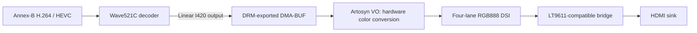

# Gnd485 decoder-to-HDMI pipeline

[Systems](README.md) · [AR9311](../soc/ar9311.md) · [HDMI experiments](../experiments/ar9311-hdmi.md)

The source Gnd485 display path combines Wave521C decoding, shared DMA buffers,
Artosyn VO, MIPI-DSI and an external HDMI bridge. Fixed-mode live output and
short 1080p60 decoder/presentation runs were demonstrated. General output
quality, sink compatibility and end-to-end video latency remain separate claims.

## Hardware identification and wiring

The reported physical marking is **Lontium LT9511 / C1311133B**. Software uses
an LT9611-compatible register interface; reads of registers 0/1/2 yielded
`17 02 e2`. This identifies useful compatibility without independently resolving
the package marking.

The bridge is on I²C bus 1 at address `0x3b`, through the DesignWare controller
at `0x01202000`, GIC SPI 33 and 400 kHz bus timing. GPIO107 supplies reset;
GPIO106 is the noted interrupt connection, but the examined Linux path polls
connector status. Board rail definitions are fixed-supply assumptions rather
than demonstrated Linux-controlled rail sequencing.

VO is at `0x08810000`, GIC SPI 70; DSI is at `0x08850000`. Early firmware still
establishes some pinmux, clocks and supplies. The reference goggle's panel timing
and power sequencing cannot be transferred unchanged to this HDMI board.

## Fixed display timing

The first generic prototype produced approximately 58 Hz from a nominal
148.5 MHz request. An empirical clock-model correction produced 60 Hz source
events, but still did not yield correct captured pixels. The accepted fixed
profile instead followed the matched stock clock and D-PHY setup:

| Setting | Recorded Gnd485 profile |
| --- | --- |
| DC clock leaf | MIPI TX PLL / 2 / 3, low selection bits `0x702`, gate bit 12 |
| DC horizontal timing | Total 2293, sync 2037–2096 |
| DC vertical timing | Total 1125, active 1080 |
| Panel control | `0x111` |
| D-PHY PLL word | `0x044e7f72` |
| DSI | Four RGB888 lanes, approximately 928.8 Mbit/s nominal, sync-event mode |
| DSI timing | HSA 44, HBP 148, HLINE 1720 |
| Measured frame-start events | Approximately 60.0088–60.009 Hz |

The accepted DRM mode is CEA-16, 1920×1080p60 at 148.5 MHz. Internal DC/DSI
values above describe the board-specific programming; they are not a claim
that a generic 2200-pixel horizontal total can replace it. The generic 891 Mbit/s
DSI setup with standard DC timing failed the controlled comparison.

## Bridge initialization

The working sequence selects MIPI input, calibrates with fixed M=`0xb6`, checks
PLL lock/calibration/band, then releases M to `0x36` and resets pixel-clock
recovery. TMDS is enabled with `0x8130 = 0xea`; after 100 ms the M release/PCR
reset is repeated with a 10 ms hold. Performing the final reset after output
enable resolved the first cold-modeset black output in that experiment.

PHY strength is `0x98`; the fixed AVI packet describes RGB, 16:9, VIC 16.
The production sequence does not enable the bridge's internal pattern generator.
Lock or calibration missing bit 7, or band `0xff`, rejects the fixed enable.

The current implementation selects this behavior with
`lontium,fixed-1080p60-quirk`, separate from the page-selector workaround
`lontium,page-select-quirk`. Neither is inferred merely from revision `e2`.
Boards without the properties retain ordinary driver behavior. The fixed
sequence does not establish DVI, audio or other HDMI modes.

HPD sometimes changed only after modeset. Early EDID reads had plausible header
bytes but invalid remainder/checksum, so a fixed forced mode was used instead
of inventing a valid EDID. Later unforced-player success is a bounded session
result, not general hotplug/EDID validation.

## DMA buffers and ownership

The decoder's internal compressed/FBC storage remains in the upper reserved
256 MiB codec pool. Displayable linear output uses a separate 32 MiB CMA pool
in lower Linux RAM. DRM buffers are exported and supplied to V4L2 CAPTURE as
DMA-BUFs. The normal player does not map, copy or convert decoded pixels on the
CPU; VO performs limited-range BT.709 I420-to-RGB conversion.

The tested video layout is 1920×1080 8-bit I420, stride 1920 and coded height
1080 or 1088. The player allocates the minimum decoder requirement plus two
buffers and retains the front buffer and one retired buffer through subsequent
completed flips. This ownership guard did not by itself eliminate HDMI artifacts.

The original RGB bring-up accepted opaque XRGB/ARGB8888 linear scanout with
pitch 8192. Later I420 support extended that specific path. Unsupported 720p
playback was rejected before activating display, although the standalone decoder
could decode 720p correctly. Decode capability is not identical to scanout support.

Diagnostic tools mapped completed frames read-only after stopping the pipeline
and matched host references. Those copies verified pixels; they did not feed
the display and were not installed as the normal playback implementation.

## Measured playback

Early CPU conversion sustained only about 8.57 fps, with approximately 109.8 ms
copy/conversion per frame. A NEON prototype reached 12.53 fps and still spent
about 65 ms per frame. These approaches were replaced by the shared-DMA path.

| Test | Result |
| --- | --- |
| HEVC 360-frame playback | Eight buffers, approximately 29.963 fps, zero late frames |
| H.264 360-frame playback | Seven buffers, approximately 29.963 fps, zero late frames |
| HEVC 600-frame 60 fps test | 600 presented, 59.909 fps including startup boundary, zero late frames/CPU pixel copies |
| H.264 600-frame 60 fps test | Same completion result |
| Instrumented steady flips | All 598 successive gaps were one vblank in each codec run; approximately 60.009 Hz |

The 60 fps clips were simple, low-bitrate ten-second sequences with moving
patterns and encoded counters, not representative high-bitrate radio endurance
tests. Valid capture portions corroborated counter advancement; black intervals
and horizontal artifacts prevented a continuous independent clean-output claim.

Final decoded-frame hashes were exact for the tested fixtures, but that does
not validate every downstream scanout/capture frame. File playback, radio
reception, UI composition, audio, scaling and glass-to-glass latency require
their own complete-system tests.
