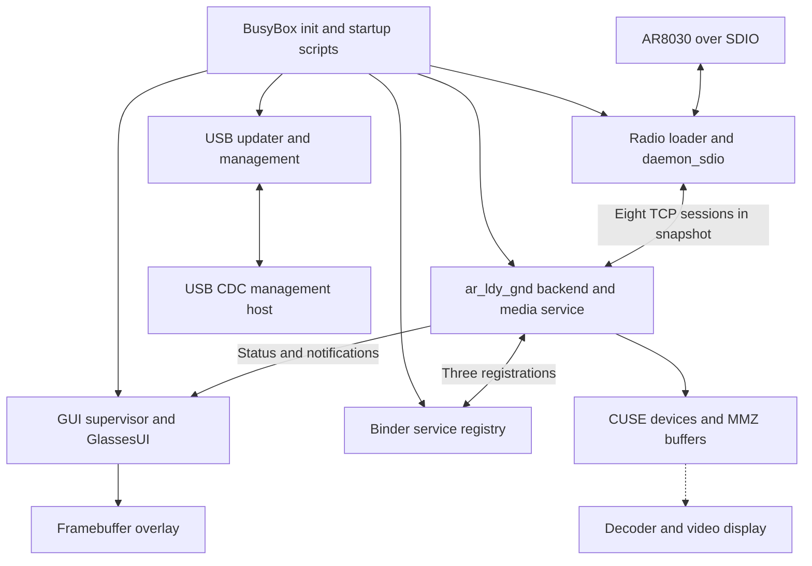

# Gnd485 stock Linux service architecture

[Systems](README.md) · [Ascent VRX](../devices/ascent-vrx.md)

The October 5, 2026 architecture collection examined the running Gnd485
17.5.3 receiver through files, process descriptors/maps, sockets, device tree
and saved boot logs. Root access already used a writable startup wrapper and
an explicitly selected 17.5.8 continuation script. This is a modified live
system snapshot, not a pristine 17.5.3 boot trace.

## Service and data boundaries

The dashed media edge was an architectural inference in the initial collection.
Later [compressed-video extraction](ascent-groundstation.md),
[display-pipeline work](ar9311-display-pipeline.md) and
[GE2D tracing](../soc/ar9311-ge2d.md) establish additional boundaries under their
own version and experiment scopes.

| Process | Observed resources and responsibility | Threads / RSS KiB |
| --- | --- | --- |
| `servicemanager` | Binder registry, `/dev/binder`; references three backend-exported nodes | 1 / 156 |
| Dropbear listener | SSH TCP 22; authentication sessions use child processes | 1 / 776 |
| `ar_fpv_upgrade` | RAM executable, four `/dev/ttyGS0` descriptors, UDP 6333 | 4 / 6,940 |
| `daemon_sdio` | `/dev/artosyn_sdio`, TCP 50000 and radio logging | 15 / 2,188 |
| `ar_ldy_gnd` | Radio client, integrated media service, CUSE/Binder/MMZ, I2C/UART/GPIO | 81 / 28,868 |
| `ar_fpv_mp_service` | TCP 6835 manufacturing/debug listener | 2 / 4,580 |
| `GlassesUI` | Qt linuxfb, `/dev/fb0`, `/dev/tty0`, GUI sockets | 8 / 87,664 |

All ran as UID 0. The values are snapshot measurements, not memory budgets;
RSS is not additive physical usage and does not account for every driver/media
allocation. Most services had parent PID 1 because launch scripts backgrounded
them. Parent PID alone does not identify which script started a process.

## Integrated media service

The backend held **124 CUSE descriptors**, three Binder descriptors, four
`/dev/mem` descriptors, MMZ and video-buffer devices, and mappings for
`libmpp_service.so`, MPI/HAL libraries, FUSE and Binder support. Thread names
included `register_dev`, `rpc_rpc_main`, `ge2d_server`, `fusion_server`,
`dis_post_proc`, `vo_sub_0`, `9611irq` and `bb_vparse`.

Saved Binder state independently shows backend PID 358 exporting nodes 3, 7
and 11, referenced by registry PID 265. This establishes three registrations;
it does not name their individual media interfaces. A separate `mpp_service.app`
launch was present in startup instructions but absent from the process snapshot.
The reason for that absence was not established. The observed service resides
inside the backend rather than one daemon per exported media device.

The backend also owned an 8,388,640-byte SysV shared-memory segment with one
attachment at capture. The manufacturing service mapped Binder-related libraries
but had no Binder descriptor. Library dependencies and generic camera device
nodes therefore cannot be treated as proof of active connections or a fitted
camera on the VRX.

## Startup dependencies

BusyBox init reads `inittab` and runs `rcS`; this stack does not use systemd.
Filesystem mounting precedes the normal/clean startup choice. The actual clean
selector is `/factory/sirius-clean-system-flag`; the differently located
`flagfile=/usrdata/...` boot parameter is not interchangeable evidence.

Normal startup loads media/system modules, with `ar_sys` configured for
`mpp_service=lib`, starts Dropbear and sources the writable continuation chain.
The study's password overlay was in place before USB networking became available.
The [access](../firmware/ascent-root-access.md) and
[startup-hook](../firmware/ascent-startup-hooks.md) pages document the modifications.

Radio startup performs board-specific GPIO/reset/card-detect work, chooses the
firmware/configuration by RF-board type and retries SDIO initialization. The
captured branch used RF board 16 and a 424,448-byte radio download; runtime SDIO
was 50 MHz with ID `4152:8031`. After more than six initialization failures,
the inspected script invokes the system reboot path. These were read startup
instructions, not a fault-injection test during architecture collection.

The GUI supervisor waits for `/tmp/flag_1080` or `/tmp/flag_720`, reloads the
framebuffer module and launches GlassesUI in the foreground, repeating after
exit. This explains why replacing a UI process and restoring its supervisor can
have display effects beyond drawing pixels. Later
[UI restoration](../experiments/kestrel-ascent-ui.md) and
[backend-only restart](ascent-groundstation.md#redirect-and-persistent-boot)
experiments exposed additional recovery limits.

## Memory and storage ownership

The live DT describes 512 MiB at physical `0x20000000`. Linux uses
`0x20000000..0x2fffffff` through `mem=256m`; the vendor anonymous MMZ occupies
`0x30000000..0x3fffffff`. Linux MemTotal was 234,656 KiB, with 16 MiB CMA inside
its region. A separate 1-MiB media SRAM zone was also reported. This is configured
and allocated memory evidence, not a destructive DRAM-capacity test.

| Mount | Backing in this boot | Persistence |
| --- | --- | --- |
| `/` | `userapp0`, MTD 16 → UBI/ubiblock → SquashFS | Read-only root image |
| `/usrdata` | `usr_data0`, MTD 18 → UBIFS | Writable persistent application/data |
| `/factory` | MTD 8 → UBIFS | Writable persistent configuration |
| `/tmp/fpvdata` | `fpv_data`, MTD 20 → UBIFS | Persistent UI/application volume |
| `/tmp`, `/dev` | tmpfs | RAM |
| `/etc/passwd` in this modified boot | File bind-mounted from tmpfs | RAM account overlay |

`/tmp/fpvdata/bin/GlassesUI` was a 20,250,960-byte executable on persistent
UBIFS. `/tmp/ar_fpv_upgrade` was instead a RAM copy, hash-identical to the root
filesystem's updater. Path prefix alone does not determine persistence.
An attempted writable remount in startup and an `ext2` fstab placeholder did
not change the observed read-only SquashFS root.

No SD filesystem was mounted at `/usrdata/record` in this snapshot. An empty
recording directory and mapped FFmpeg libraries do not establish DVR behavior.
Paired partitions also did not, by themselves, prove automatic rollback. See
the [NAND/GPT study](../firmware/gnd485-nand-and-gpt.md) and
[updater analysis](../firmware/ascent-stock-updater.md) for later reconstruction.

## Network, USB and control

Ownership was established by matching procfs socket inodes to process FDs.
The backend had eight established loopback connections to radio TCP 50000 and
one outbound connection to the GUI's TCP 2765 server. These are application
sessions, not eight RF peers or independent video streams.

| Endpoint | Owner | Interpretation after later studies |
| --- | --- | --- |
| TCP 22, IPv4/IPv6 | Dropbear | SSH |
| TCP 50000 | Radio daemon | Vendor host RPC and socket transport |
| TCP 2765 | GUI | Backend-pushed status/notifications; not a broadcast subscription port |
| TCP 2767 | Backend | GUI command protocol |
| TCP 5809 | Backend | Video-file playback ingress identified later |
| TCP 6835 | Manufacturing service | Listener verified; broad debug operations not validated |
| UDP loopback 6222 | GUI | Menu-key subset decoded later on 18.21.10 |
| UDP 4486 | Backend | Debug dispatch traced later |
| UDP 4208 | Backend | Bound socket; role unresolved in this study |
| UDP 55001 | GUI | Bound socket; role unresolved in this study |
| UDP 6333 | Updater | Datagram application protocol not validated here |

Except for loopback UDP 6222, those IPv4 listeners/binds used all interfaces
in the snapshot. TIME_WAIT sockets at 2767 did not identify their former client.
See [backend control](../protocols/ascent-backend-control.md),
[later MSP forwarding](../protocols/ascent-stock-msp.md) and
[UI input](kestrel-software-ui.md) for resolved formats.

The DWC2 gadget exposed RNDIS plus CDC ACM, VID/PID `1d75:0101`, with USB IP
`192.168.3.102/24` and no device default route in this snapshot. Physical `eth0`
was down/unaddressed. No active UVC, mass-storage, MTP or ADB function was
present; compiled drivers did not make those interfaces available. The existing
ACM endpoint belonged to binary updater control, not a shell. Optional Wi-Fi
startup code likewise did not establish a live Wi-Fi interface.

## Artifact identity and measurement method

| Live artifact | SHA256 |
| --- | --- |
| Backend | `80d4d78de68198e1042f4ebbf9aa33353bc21cf2c2746f85e20c9755b04a074b` |
| Radio daemon | `9d552b6a3b7647178da4b2d9fc2fbf19770c43c88fcfd4447cb10b03fcea43b9` |
| Radio container | `0443b9deed591bae3f54ed2df498492312c57c29b4d57bfc2d0085bba78c90e8` |
| Radio configuration | `05b5b5511d80b27aa2c517bb5f2e7f6c47b3f6a6a34f0fb2ee1444d3061b4b14` |
| GlassesUI | `0d38f566147ee250a898895bdb0c304479d02c4e9083c5cb7e79cbbd6b556407` |
| Updater, root and RAM copies | `29f929d08cbfede276bbaec2d7ef4f091eba1f31c69801cc00ef38848a08eea2` |

The original collection passed shell text over SSH without installing collectors
or changing configuration. Its first inventory lacked `/sbin` in PATH and tried
unsupported `netstat -p`; a follow-up corrected those limitations. The saved
process/socket normalization was reviewed separately from raw capture excerpts.
Device wall-clock output was not used to date the host's collection.

Offline parser tests exercised mapped-file deduplication, descriptor counting,
IPv4/IPv6 byte order and unknown socket owners. Such tests validate the collector's
interpretation, not active video, physical memory capacity or every exported
vendor service. Later evidence should be added with matching firmware hashes
rather than treating this snapshot as an unchanging platform specification.
