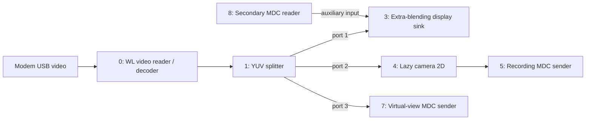

# DJI Goggles 3 receiver architecture as a comparison

[Systems index](README.md) · [Documentation index](../../README.md)

## Scope and evidence

The October 12, 2026 study examined Goggles 3 **v01.00.1400** system and vendor
partitions. It provides a useful comparison for separating radio, application
processor, decoder, display, recording and OSD responsibilities in an FPV receiver.
It does not identify DJI hardware as Artosyn hardware or establish interoperability.

This was static analysis: no DJI firmware was executed, no live radio link was
captured, and neither the boot ramdisk nor modem executables were decrypted.
The separate [O4 interface comparison](../devices/dji-o4-interface-comparison.md)
preserves the manufacturer-documentation layer and its historical scope.
Android 9, `e3t_zv902`, AArch64 userspace and E3T product configuration are visible
in the extracted application software. The [extraction record](../firmware/dji-package-boundaries.md)
identifies the images and the limits of checksum/signature verification.

## Application processor and modem

The receiver separates an E3T application domain from a Sparrow2/S2 modem domain.
E3T runs Android services, DUML/DUSS routing, codec/media software, display, UI,
OSD, recording and sharing. Product-specific modem resources provide compatibility
profiles, boot resources, NVRAM, pairing and link-state management. Some services
also call the modem `pigeon`; this name alone does not identify another chip.

| Product | UI/product code | SDR type / modem drone type | Receiver profile | SDR ID |
| --- | --- | --- | --- | --- |
| O3 Air Unit | `wm169unit`, 124 | 80 | `wm1695` | `0x2828` (10280) |
| O4 Air Unit | `za530`, 140 | 113 | `za530_lite` | `0xbe01` |
| O4 Air Unit Pro | `za5305`, 141 | 114 | `za530_pro` | `0xbc01` |

Each profile contains `ap.img`, `cp.img`, `l1c.img`, `dsp.img`, `scp.img` and
five data/NVRAM files. Their names suggest separately packaged processing domains;
their exact cores and RF responsibilities remain unresolved. These are receiver
compatibility resources, not air-unit camera/ISP firmware.

The compatibility table enables multi-type support but defaults to **WA520**,
with `switch_ap_mask: 0` and `pair_auto_switch: 0`. Profile availability does not
prove automatic selection on pairing. Firmware staging, modem reboot and state
reporting are visible in agent diagnostics, but the complete runtime sequence
was not traced.

## Internal USB and control paths

The configured modem device is VID `0x2ca3`, PID `0x1020`. IN/OUT directions below
are relative to the application processor acting as USB host.

| Purpose | Interface | IN / OUT endpoints | Configured behavior |
| --- | --- | --- | --- |
| Main video | 3 | `0x84` / `0x04` | WL port 0; receive length 2040 |
| DUML commands | 4 | `0x85` / `0x05` | `/bulk/s2`, mode-dependent routing |
| Secondary video | 0 | `0x81` / `0x01` | WL port 1; optional 640×360 path |
| Modem diagnostics | 7 | `0x88` / `0x08` | `/bulk/s2_da`, enabled |
| Modem dump | 6 | `0x87` / `0x07` | `/bulk/s2_sdrdump`, disabled |

The modem log configuration also names `/dev/ttyS1` at 921600 baud. These are
firmware settings, not measurements of a physical connector.

`dji_wlm` uses logical local host `0x0e07` and peer `0x0907` for link management,
capability negotiation and route handling. `dji_sdrs_agent` is `vt_gnd`, index 4,
and handles modem boot/profile/NVRAM, pairing and heartbeat state. The glass
router is `glass`, index 1. Logical module identifiers are not USB endpoint
numbers or necessarily process IDs, and the modem agent is not the whole decoder.

The canonical DUML configuration contains repeated, mode-dependent keys. A
normal JSON-to-dictionary conversion can silently discard routes. A reproduction
must preserve duplicate key/value pairs or inspect the textual route tables.
The separate diagnostic configuration has a different profile table.

## Configured live-view graph

The main graph is selected by the live-view work-mode library. The arrows below
reproduce its configured node connections; labels after the sinks describe their
consumer roles.

Defaults are H.265 input and 1920×1080 YUV420SP output, with seven buffers at
several ports. They do not establish the negotiated codec/resolution of every
pairing or seven permanently queued frames. The secondary reader is wired to the
sink, but `enable_aux_liveview` is **false**. It is not evidence of a second O3 camera.

GDC node 2 and MCTF node 6 exist as definitions but have **no graph edges**.
Drawing them inline would invent mandatory processing stages.

The software exposes WLM receive channels, codec frame-start/frame-full callbacks,
timestamps, decoder state and display skipping, plus `duss_hal_vdec_decstrm`,
`/dev/wl_vdec0`–`3`, `dji_wl.ko`, `vc_decoder.ko` and ION interfaces. Together these
support a hardware-assisted decode architecture. Exact codec IP ownership,
universal zero-copy operation and runtime queue occupancy are not established.

## Display timing and OSD

The primary display library contains blending, VSYNC, timing selection, frame-rate
mapping and phase-control mechanisms; the HAL registers `/dev/dji_display`.
Selected WM1695 entries illustrate source-aware timing:

| Source FPS entry | Configured 1920×1080 display refresh |
| --- | --- |
| 29.984648 | 59.969 Hz |
| 59.969296 | 59.969 Hz |
| 49.87619516 | 99.75 Hz |
| 99.89131 | 99.892 Hz |

Other entries near 200/240 source FPS do not establish advertised modes; the media
configuration caps display FPS at 100. Matching refresh rate, aligning phase and
displaying an incomplete picture are three different capabilities. Static timing
code proves neither actual latency nor partial-picture scan-out. IRIS6 scripts
and selectable E3T/pigeon MIPI sources also leave physical panel wiring unresolved.

The goggles UI contains external-flight-controller DisplayPort command, row and
layout models, `decodeBF`/`decodeINAV` functions and corresponding font identifiers.
This is specific evidence for a goggles-side character/row OSD renderer. Air-side
serial translation and the runtime display-plane path remain untraced. Compare
the independently documented [Ascent forwarded MSP](../protocols/ascent-stock-msp.md)
and [Kestrel software HUD](kestrel-software-ui.md).

## Recording, virtual view and sharing

| Branch | Configured input and processing | Interpretation |
| --- | --- | --- |
| Local recording | Lazy 2D branch → `zv900_liveview_pigeon_chn`; H.264/MP4 with background remux | Default 30 Mb/s, profile values 30/30/40 Mb/s; local recording bitrate |
| Virtual/AR view | `liveview_wlvdec_chn` → two C2D composition nodes → DSP projector/graphics | Alternative work-mode path, not mandatory FPV processing |
| App export | `zv900_liveview_lcdc_chn` → VC8000E H.264 | Default 10 Mb/s; separate encoded export |
| Wi-Fi sharing | Same LCDC-named channel → WL encoder; `/tmp/liveview_to_wifi` | Separate sharing configuration, including GDR options |

The LCDC-named channel's consumers are explicit. Its exact producer tap is not
an edge in the main graph and remains inferred. Neither recording bitrate nor
Wi-Fi encoder settings specify the air-to-goggles RF stream. Fan-out also does
not by itself prove that a slow consumer cannot retain shared buffers.

Normal product startup loads codec/WL/DSP drivers and activates media, UI, WLM,
modem, camera, security and update services. Charger boot differs; some service
definitions lie outside the extracted partitions. GFSK/nRF52810, Wi-Fi/Bluetooth,
local VST cameras and IMU/ICC services are ancillary observations, not evidence
that the main O3 PHY is ordinary Wi-Fi or GFSK.

## Comparison boundaries

The useful comparison with [Ascent stock architecture](ascent-stock-architecture.md)
is functional: radio transport, decode, display, control and optional export have
separate ownership. Shared-library capabilities must be separated from the active
graph and the negotiated product mode. The [receiver contracts](../protocols/dji-receiver-contracts.md)
give further framing, metadata and recovery details with the same limits.

RF modulation/FEC, radio-session ciphering, modem core responsibilities, active
slice release, panel routing, air-unit software and measured glass-to-glass
latency remain outside this static receiver result.
