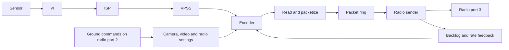

# Kestrel Air: camera, encoder and radio ownership

[Systems](README.md) · [Documentation index](../../README.md)

Kestrel Air replaces the stock air application and connects camera output to
the AR8030 through ar_libre. Its two hardware backends share application framing
but have different camera pipelines and capabilities. This page describes the
reviewed implementation and its research notes; physical P1 acceptance results
are recorded separately in the [P1 source-stack experiment](../experiments/p1-source-stack.md).

## Backend boundaries

| Property | HiSilicon backend | AR9311 / P1 backend |
| --- | --- | --- |
| Application target | Ascent Lite / Lite+, CV610 SDK profile | BETAFPV P1 Air |
| Sensor support | CV2004 or OS02K10, selected through sensor ID reads | SC231AI |
| Camera/encoder interface | Vendor MPI and sensor libraries | Source Linux V4L2 drivers |
| Compressed output | HEVC slices sent as they become available | Complete 1920×1080, 60 fps HEVC pictures |
| Refresh | Configurable intra refresh or periodic keyframes | Periodic IDRs; no intra refresh |
| Hardware controls | Lite-family controls and optional camera IMU | P1 input/LED devices; no HiSilicon MMIO or ADC controls |

The Lite software profile does not independently identify its physical SoC
package. See the [device study](../devices/ascent-lite-vtx.md) for that evidence
boundary. Linking against empty MPI stubs is a build mechanism: the HiSilicon
application still loads the real vendor ISP, media and sensor libraries on the
device. It is not a replacement implementation of those libraries.

Both backends use ar_libre's client directly through the radio device, without
the stock radio daemon. The HiSilicon notes describe `/dev/artosyn_sdio` or
`/dev/arlink0`. The P1 source stack uses native arlink framing; its stock SDIO
block trailer belongs to a different transport path.

## Data flow and resource ownership

This diagram is the HiSilicon path. Radio ports 2 and 3 are application socket
identifiers in the radio transport, not TCP port numbers. Ground frames are
acknowledged before command execution; configuration changes can be applied by
a separate worker so they do not block reception. The
[application-stream study](../protocols/ascent-application-streams.md) defines
the framing, feature bits, reports and commands.

The read thread owns encoder creation, recreation and packet construction. The
send thread drains the ring and measures radio-write duration. A third thread
pauses encoder input when the encoder backlog reaches six or the send path is
marked busy. Local ring depth of at least 16 marks it busy; depth of at least
10 can trigger rate reduction when the relevant flow-control bit is enabled.
Radio and relay backlog add their own pressure. These are source policies,
not measurements of a guaranteed maximum latency.

Each reserved packet is bounded by `0x80000` bytes, including framing and any
IMU suffix. Parameter sets are accumulated ahead of a keyframe. Radio writes
default to an outstanding window of one; a larger `--bb-window` permits
multiple writes in flight. Link loss stops the encoder and flushes queued
packets. The bus-watchdog contract is exit status 2 followed by a wrapper reboot;
this source review did not exercise that hardware recovery path.

The HiSilicon notes report that restarting a camera already initialized by
another application can fail at `OT_MPI_ISP_MemInit` until reboot. Camera and
radio ownership therefore matters when interpreting startup failures.

On P1, capture exports three-plane YUV420M DMA-BUFs and retains each buffer
until the encoder's OUTPUT queue returns it. Only the compressed bytes enter
the shared packet ring. AE/AWB workers start after eight capture frames;
controller failure or stalled capture terminates the application visibly.
The [P1 camera study](../soc/ar9311-p1-camera.md) describes the driver chain,
and [persistent settings](../firmware/p1-calibration-and-settings.md) covers
calibration, peer configuration and atomic updates.

## HiSilicon low-delay settings

| Setting | Reviewed default or behavior |
| --- | --- |
| `KA_IR` | Two CTU rows refreshed per picture; zero selects periodic keyframes |
| `KA_IR_MODE` | Row mode, zero; one selects columns |
| `KA_IR_QP` | Requested intra-refresh QP 32 |
| `KA_GOP` | One refresh sweep: 17 pictures at 1080p with two rows; 25 without intra refresh |
| `KA_SLICE_COUNT` | Two above 60 fps, four at 60 fps or below |
| `KA_LD_LINES` | VPSS steps of 128 lines with intra refresh, 64 without |
| `KA_LATINFO` | Enabled; adds Kestrel timing and identity fields |
| `KA_BW40` | Disabled; optional air-side automatic bandwidth control |

The notes report that CV610 refreshes once per GOP, then waits for the next GOP
start, which is a P picture in this mode. A live GOP change can disable intra
refresh, so changes to refresh mode, amount, QP or GOP recreate the encoder
between pictures. The RAM-only `/tmp/ka-tune` file supports live experiments;
omitted names revert to defaults rather than retaining the previous file's
values. VPSS line steps remain those selected at startup. Enabling intra
refresh after starting without it can consequently halve output frame rate.

Earlier 32-line experiments reported roughly 0.3 ms improvement over 64 lines,
but sometimes produced only every other picture. Those observations explain
the more conservative defaults; they are not a general performance guarantee.

The optional air-side 40 MHz controller re-forms the link when changing width.
The research notes report about 0.7 seconds without picture and conflicting
behavior when both air and fpvOS ground independently control bandwidth. Its
default remains off; controller ownership is part of the matched setup.

## Timing fields and their limits

Capture PTS uses monotonic microseconds. The sender reports capture-to-encoder
output, local queue wait, and the **previous** packet's radio-write duration in
10 µs units. Each 16-bit duration saturates at 655.35 ms. The legacy one-byte
capture-to-build millisecond field instead wraps on conversion to `uint8_t`.
These fields measure different boundaries and should not be added as if every
one described the same packet's complete optical latency.

The radio-clock stamp has whole milliseconds plus a fraction in 1/256 ms
steps. That is a representation resolution of about 3.91 µs, not measured
clock accuracy. The implementation prefers radio frame-edge alignment and
otherwise estimates offset from radio-clock requests. It rejects requests
taking over 2 ms, smooths accepted offset updates by one eighth, and resets
on reconnect or an offset jump over 20 ms. Background offset sampling continues
while edge alignment is available so fallback does not begin with a stale
estimate.

Before either fine estimate is available, packet construction uses the older
millisecond offset and fraction 128. The HiSilicon feature function still
advertises `KA_FEAT_APCLOCK` when latency information is enabled: that bit is
not a per-packet guarantee of valid frame-edge synchronization. The reviewed
P1 feature function does not advertise these HiSilicon timing capabilities.

## Optional camera IMU metadata

The HiSilicon research identifies an ICM-40609-D on SPI0 chip select 0. The
implementation checks identity `0x3b`, selects SPI mode 3 at 4 MHz, and requests
1 kHz gyro/accelerometer FIFO sampling at ±2000 dps and ±32 g. `--imu` is off
by default; stock-ground compatibility was not tested in the recorded notes.

Samples are appended after the last video slice as HEVC suffix-SEI type 40,
with `user_data_unregistered` payload type 5 and emulation prevention. The
payload below is little-endian; sample axes are the chip's axes.

| Offset | Size | Meaning |
| --- | --- | --- |
| 0 | 16 | ASCII `kestrel-air-IMU1` followed by a NUL byte |
| 16 | 1 | Format version 1 |
| 17 | 1 | Flags; bit 0 marks discarded stale software backlog |
| 18 | 2 | Picture number |
| 20 | 8 | Picture capture PTS, µs |
| 28 | 8 | First sample time, monotonic µs |
| 36 | 2 | Sample count |
| 38 | 2 | Gyro scale value 164, representing ten times 16.4 LSB/(degree/second) |
| 40 | 2 | Accelerometer scale, 1024 LSB/g |
| 42 | 14 × count | `u16` sample-time delta in µs, then six `i16` values: gx, gy, gz, ax, ay, az |

The gyro scale's source comment calls it “LSB per 0.1 dps,” but the emitted
value and range constants disagree with that wording. With the reviewed value
164, convert gyro raw values using `raw × 10 / 164` degrees/second; treating
164 literally as LSB per 0.1 degrees/second introduces a factor-of-100 error.

Sample times are estimated from FIFO read times and sample sequence numbers,
using a fitted period and lower-envelope offset. The sensor's 16-bit timestamp
is used to detect missing packets, not directly exported as the capture clock.
The implementation forces output times to increase. This establishes a timing
algorithm, not a measured absolute synchronization error.

An SEI message holds at most 100 samples over at most 60 ms, with at most three
messages appended per picture. More than 400 pending samples drops the backlog
to the newest 100 and sets flag bit 0. Hardware FIFO overflow and detected packet
loss have separate counters; they do not themselves set that SEI flag. Samples
are consumed before the suffix is encoded, so insufficient packet space can
also discard a batch without flagging it. The metadata is not a lossless log.

The project notes say Kestrel Ground removes SEI before decoding, so its DVR
does not retain these samples. An air-side Annex-B dump can preserve them.
The reported unchanged decoded pictures and first-slice latency were not
independently re-measured during this documentation review.

## Validation boundary

An isolated host build of the reviewed source passed 236 checks, the atomic
storage error/interruption checks, and the AR9311 platform and mocked input
checks. These cover protocol/helpers and selected platform separation, not
camera capture, radio association, IMU timing, or end-to-end video. The existing
P1 experiment provides its own dated physical acceptance evidence.
