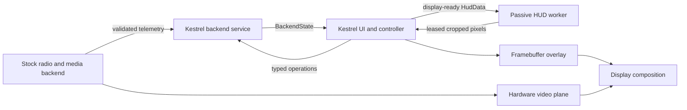

# Kestrel software UI on stock Ascent

[Systems](README.md) · [Device validation](../experiments/kestrel-ascent-ui.md)

The standalone AR9311 Kestrel UI renders a software overlay while the stock
`ar_ldy_gnd` backend and `daemon_sdio` retain radio, decode and video display.
Live HDMI video with this HUD was confirmed on Gnd485 firmware 18.21.10.
This is a distinct milestone from a native replacement of the complete receiver
media/radio stack.

## Process ownership

The first bring-up connected the UI directly to the stock telemetry endpoint.
The later service architecture moves that parsing into `kestrel-gnd`; these
are alternative owners of the same endpoint, not simultaneous subscribers.

| Process | Owns | Does not establish |
| --- | --- | --- |
| Backend service | Telemetry validation/freshness, normalized state, capabilities, typed operation dispatch and recording catalog | Native radio/decoder ownership on the `ascent-stock` adapter |
| UI | Input, preferences, menu/controller state, final overlay composition, `/dev/fb0` | Authority to infer successful hardware settings from an ACK |
| HUD worker | Drawing supplied display-ready data into leased shared buffers | Direct telemetry parsing, UART/input/framebuffer or media ownership |

The stock adapter reports `hardware_delegated=true`. It advertises telemetry
and optionally a read-only recording catalog. Pairing, radio/camera settings,
recording and playback controls return `unsupported`; their command types are
interfaces for future validated implementations. Unknown recording state stays
unknown. Gallery visibility hooks are not an implemented gallery/playback engine.

The service boundary was exercised with host fixtures and process tests. The
recorded physical UI/HUD recovery test used the direct stock connection; it must
not be silently relabeled as hardware validation of every later service adapter.

## Rendering without a GLES dependency

LVGL 9.2.2, pinned at `7f07a129e8d77f4984fff8e623fd5be18ff42e74`, renders the
standalone UI. Its static ARM64 build needs no EGL/GLES/GBM/DRM/FFmpeg runtime.
Decoded video never enters the UI process. The existing RK3568 GLES receiver
remains a separate application path.

Canopy uses host-baked cropped alpha masks and Chakra Petch SemiBold glyphs.
The original planar transforms project glyph quads; inverse homography and
bilinear CPU sampling preserve perspective and readable right-wing text.
The font atlas contains 99 glyphs in 243,022 bytes and travels with its OFL
license. At 1080p the two panel masks total 292,678 bytes.

Projected masks are cached independently of color so theme changes reuse them.
The initial single-process text cache had a 1-MiB soft budget; later process
separation assigns 512 KiB to each renderer. Cache references are dropped before
their backing pixels are released. This matters because deferred draw work can
otherwise retain a pointer into an evicted image.

Menu motion uses opaque cached snapshots and updates the changing reveal strips.
The 192-row partial draw buffer reduces repeated callbacks without allocating
another full-screen draw surface. Absolute deadlines skip expired animation
poses. UI cadence is a local 1–60 Hz limit, independent of video rate, and does
not promise a rendered frame at every deadline.

## Canopy and Vector

Canopy is the default passive renderer. Its two shared slots contain three
cropped regions and total 7,188,480 bytes at 1080p. Vector uses seven cropped
regions and 11,663,472 bytes for two slots. Neither requires two full-screen
shared images. The IPC contract permits at most eight validated regions.

Vector draws framed voltage/current and RC instruments with a transparent
center. The controller supplies labels, values, units, validity and gauge levels;
the renderer does not invent telemetry. A pack-voltage scale of 0–30 V is an
engineering scale, not battery capacity. The fixed central sight is decorative,
not measured attitude. `UI LIMIT` is not decoder FPS. Unresolved RF temperature,
frequency and quality semantics remain explicitly raw.

Region fingerprints allow unchanged pixels to be copied from the previous
leased frame instead of rerasterizing static text/arcs. Damage masks also prevent
the UI from repainting an unrelated instrument when only RSSI changes.

## Input and preferences

The common controller implements a GOGGLE/AIR UNIT picker, section/row
navigation and preview/apply/cancel transactions bound to stable row IDs.
Local settings are theme, detail rows, UI cadence and arrow-repeat policy.
Save failures roll back previews. Rendering does not write RF/camera settings.

Inputs include terminal keys, optional evdev, an owner-only local control socket
and the mapped stock UDP key subset. The latter listens on loopback port 6222:

| Byte | Meaning |
| --- | --- |
| 0 | Source `0x40` |
| 1 | 0 Up, 1 Down, 2 Left, 3 Right, 4 OK, 7 Back |
| 2 | 0 normal event, 2 subject to arrow-repeat policy |

Long/debug, record and pairing inputs were not admitted by this subset. GPIO
4/5/6 strings in GlassesUI identify board straps, not a button poller. GPIO 106
remains backend-owned. The receiver exposed no evdev input devices in this test.

Preferences use a versioned UI-only file, checked values, a same-directory
temporary file, mode 0600, checked writes, fsync and rename. Preview/cancel do
not save. The device harness used RAM staging, so power cycling removed those
preferences; it did not change vendor boot or persistent configuration.

## Isolation and remaining work

The UI retains menu/edit state when the HUD restarts. Gallery scenes immediately
hide the HUD and send one disabled snapshot, while telemetry reception continues.
The worker renders only supplied data and has no additional backend connection.
See the [local IPC contracts](../protocols/kestrel-local-ipc.md) for slot lifetime,
session freshness and command uncertainty.

The UI respects framebuffer stride, channel/page offsets and saves/restores its
visible surface. Its test wrapper stops the stock GUI supervisor and restores it
afterward. That stock restoration can reload the framebuffer module; a recorded
restore incident required a power cycle. Normal cleanup is not a guarantee of
fault-free live handover.

Full Betaflight grid/glyph output, wider telemetry, reactive effects, native
media controls, reconnect/resolution changes and measured tearing/latency remain
separate work. [GE2D copies](../soc/ar9311-ge2d.md) were tested offscreen and are
not an integrated accelerated UI compositor.
