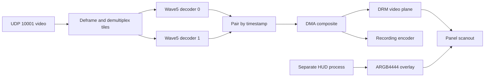

# VR04 reference open video, HUD and recording

[Systems](README.md) · [Reference board](../devices/betafpv-vr04-reference.md)

## Scope and deployment stages

The retained MissingLynk sources describe a GStreamer/Wave5/DRM pipeline and
separate LVGL HUD on the open reference goggle. This article consolidates userspace
revision `674ec00ecde0bba2eb844def1b4a0b7f8e685e13`, including selected later code
paths where the introductory README retained older behavior. Hardware results
are reported from the research; no new device deployment was performed here.

The development package used dynamic GStreamer in an SD-card squashfs mounted
at `/mnt/gst`. This preserved a normal library/symlink filesystem on the exFAT
card. The production path instead linked the selected GStreamer components into
standalone static binaries in the rootfs. A dynamically linked executable could
not run against the minimal production rootfs without those libraries. Recorded
binary sizes changed over development and are not a reliable ABI test by themselves.

Early dynamic startup spent about 19 seconds scanning 238 plugins; persisting its
registry reduced warm startup below one second. The selective static build avoids
that dynamic registry scan. Running the pipeline without SD-hosted libraries is
distinct from recording to SD: recordings still use the mounted storage volume.

## Video and display ownership

The default product launcher chooses composite mode. The bare pipeline's default
is direct tile scanout unless the `ML_COMPOSE` environment variable is present;
the inspected code checks presence, not whether its text equals `1`. A startup
DVR request also forces composite mode. Those are compatible defaults at different
entry points, not contradictory measurements.

The current allocator prefers MMZ unless overridden; the dynamic launcher's
comment claiming a CMA default is stale. Its measured CMA configurations remain
separate. The [compositor study](vr04-compositor.md) gives the actual allocation
requests, pool gates and fallback rules.

The launcher requires the DRM broker socket. A missing DMA-blit device or a
nonzero decoder capture-buffer cap produces a warning and still launches the
pipeline; those checks do not enforce the reported default performance.

| Mode | Resource and functional tradeoff |
| --- | --- |
| Direct tile scanout | Two video planes carry decoded tile buffers directly; no assembled recording frame and no free overlay bank for HUD |
| Composite | DMA copies the two tiles into one 1080p I420 buffer; leaves an overlay bank for HUD and supplies a recording input |

The early direct/composite comparison reported about 2.5 ms extra compose cost,
47 MB extra pool use and 3.4 percentage points of total CPU use. Those belong to
that pool/build configuration and are not full camera-to-screen latency figures.
Later default-runtime measurements used a full-depth CMA composite pool and
reported 62 fps, zero evictions and 2750 DMA versus zero CPU blits. That rate
does not establish the panel's calibrated refresh; the
[timing study](../experiments/vr04-receiver-latency.md) retains conflicting mappings.

Without the DMA-blit device, CPU composition was reported around 40 fps at high
CPU load. Reducing pool depth also produced roughly 40 fps, but with idle CPU
and rising evictions. These are different bottlenecks. Old reserved-heap pool
sizes and later CMA policy must not be combined into one fixed memory budget.

## Buffer lifetime, pairing and session changes

Early file playback reached reported 1080p60 with DMA-BUF decoder output imported
by `kmssink`. The later RF path replaced that sink because its skip-vsync release
could return buffers while display hardware still fetched them. The custom sink
retains an extra generation: retirement occurs one flip later than a simple
parent/front replacement. The implementation attributes this to a possible
one-frame difference between software vblank event accounting and hardware latch.

Two RF tiles are paired by PTS/FrameId in a bounded slot table. An incomplete
oldest pair can be evicted; display waits for both halves rather than combining
different frames. Tile-0 admission is gated when it outruns the other decoder,
with limits derived from the available backing pool. Tile 1 continues flowing.
These rules address skew and storage pressure, not proof that no upstream frame
is ever lost.

The allocation query advertises `GstVideoMeta`. Otherwise GStreamer could
normalize-copy the 552-row tile into system memory, defeating the intended
DMA-BUF path. Plane placement and allocation padding are separate: the current
layout helper honors populated metadata, then caps, and its final fallback
places chroma after 552 image rows for the 1920×552 tile. Assuming 560 rows
from allocation alignment alone contradicts that fallback and its recorded
render comparison. See the [frame-ownership study](vr04-frame-ownership.md#pairing-and-tile-layout).

A FrameId regression advances a timestamp epoch so decoder PTS remains monotonic;
it does not require a live decoder flush for every new air session. The retained
rebuild helper is unused; it does not automatically recover parameter changes.
Compressed input is not arbitrarily leaked from the middle of a prediction chain:
the receiver uses a 4 MiB queue threshold with drop-until-IRAP resynchronization.
Its pre-enqueue check and IRAP bypass permit overshoot; separate access-unit holds
also consume memory. Merely configuring a nonblocking `appsrc` maximum does not
enforce a hard cap or make every push fail when full.

Mode changes tear down the old graph before starting its replacement, and park
scanout on a persistent idle framebuffer before freeing decoded buffers. An
overlap between teardown and a new instance historically hung the SoC. Later
reset/reload changes supersede the README's absolute “cold power only” statement;
their remaining limits are in the [codec validation](../experiments/vr04-media-validation.md).
The [display review](vr04-frame-ownership.md#event-identity-and-the-ineffective-timeout-fallback)
also identifies an ineffective timeout callback and unchecked parking/disable
failures. Attempted teardown ordering alone does not prove hardware quiescence.

## HUD and local interfaces

The radio daemon owns UDP 10000, while the video process owns 10001. The HUD
receives canvas and status over separate [MLM sockets](../protocols/mlm-ipc.md).
Recorded-packet replay uses those same HUD inputs; it tests consumers without
proving live RF delivery. Replay and the live radio producer must not both
pretend to be the sole source during a controlled replay test.

The HUD uses a transparent ARGB4444 DRM overlay. The primary video/splash is
owned by the display service or pipeline, not painted by the HUD. The old vendor
`arfb` interface is not this open DRM backend; that distinction does not mean a
DRM-provided console framebuffer can never exist.

The retained splash asset is raw I420 at 1920×1080, exactly 3,110,400 bytes,
staged as `/usr/local/share/nosignal.yuv` and painted by `ml-splash` on the DRM
primary. Its source-image conversion expects a 16:9 image. This userspace
splash does not establish a bootloader or pre-kernel display path.

Menu closed shows the FC canvas and System OSD. Menu open hides the on-screen FC
canvas behind settings while retaining the system bar at the bottom. Changed-cell
rendering avoids rewriting the whole overlay; the report contrasts near-idle
CPU for its captured workload with a full-frame implementation that pegged a core.
This is not a measured zero-cost bound for every menu or glyph update.

Settings persist in `/usrdata/hud/settings.json`. Recorded working UI features
include brightness, buzzer/key tones, voltage alarms, language changes, status-bar
fields, recording lists and an air-unit section gated by link presence. The
[canvas study](../protocols/vr04-msp-canvas.md) separates the checked font/grid
behavior from nonzero attributes and parser edge cases.

Video and HUD share a DRM file description through a broker. Later video owns
flip-event consumption; the old “blocking SetPlane only” overview predates this.
The HUD also suppresses redundant overlay commits while fresh live-video state
shows flips within the previous 500 ms. It resumes its own refresh without video.
This avoids the documented extra-vblank contention without hiding the overlay.

## Recording, OSD and subtitles

Recording consumes the assembled composite. H.264 is the recorded default;
HEVC is opt-in. Reported native 1080p60 MP4 output alongside live display does
not settle every historical HEVC instance-reuse failure. The
[codec record](../experiments/vr04-media-validation.md) preserves that distinction,
and the [stock/open media study](vr04-stock-media.md) covers hardware downscaling
and frame-rate selection before the encoder.

The [recording and restream review](vr04-recording-restream.md) follows the shared
encoder, input queues and file lifecycle. Recording state does not wait for the
first encoded picture, and stop does not require a successful EOS result before
teardown. Fragmented MP4 configuration alone does not establish power-loss safety.

Ordinary overlay scanout leaves recording pixels unchanged. Optional FC-OSD
burn-in is a separate operation: the HUD sends changed, rendered glyph cells,
and the pipeline caches Y/U/V byte spans to overwrite in each composite before
cache synchronization and encoding. It includes the FC glyphs, not the settings
menu or System OSD bar. Its independent grid copy lets recording retain those
glyphs while the on-screen menu hides them.

The inspected converter uses a limited-range BT.601 RGB-to-YUV matrix and binary
alpha threshold 128. A chroma sample is replaced when opaque glyph pixels cover
at least half of the patch pixels sharing that 2×2 block. Border video pixels
can consequently share glyph chroma; this is not general source-over blending
or proof of lossless visual equivalence. Conversion happens on cell changes;
per-frame work is copying cached spans into existing composite memory. The
claim of no extra CMA/MMZ concerns this cache, not zero CPU/heap memory use.

Optional SRT sidecars are created lazily when the HUD sends telemetry text during
recording. The pipeline timestamps it relative to video PTS and uses the same
basename as the MP4. The recorded fields include signal, channel, flight time,
air/goggle battery, bitrate, distance and optional temperatures. These come from
HUD telemetry caches, not a flight-controller canvas hidden in video SEI.
Their timestamp follows attempted encoder-input PTS; a stalled timeline can
produce overlapping cues, and failed input submission is not excluded from
that clock. These sidecars are not an independently verified MP4 frame timeline.

## Playback and visible-output limits

Playback preempts the application's live RF decode graph and uses the custom
display sink with pinned decoder buffers. This is a resource policy of this
application, not evidence that the SoC has only one decoder: live RF already
uses two instances. The interactive MP4 probe selects H.264 or HEVC and detects
native geometry, subject to its metadata-search limits. The HUD prefers length
from MP4 headers, including fragmented-file metadata; the pipeline separately
polls a duration that can still grow. The list hides files below 64 KiB using a
size heuristic, not a decode test. The [playback study](vr04-playback.md) details
these readers, scaling prerequisites and the separate standalone file path.

The HUD holds its loading state until the pipeline signals first-frame submission.
The later implementation **holds the final frame at end-of-clip**, retaining
playback mode and an ended flag. Explicit stop returns to live; the inspected
fatal-error handler also requests live recovery. Older prose saying every EOS
automatically returns to RF is superseded. The HUD replays an ended clip with
a new PLAY command; direct resume or speed changes do not reset the ended flag
and position timer. Recovery attempts contain unchecked transitions and waits
without an overall deadline.

Forward 2×/4×/8× playback is reported validated. The speed function actually uses
a flush/key-unit rate seek, with trickmode flags away from 1×. Reverse is not
hardware-qualified; a negative-speed menu entry is not proof it works. The
record's separate warning about live Wave5 flush stalls cannot be resolved into
a blanket claim that no playback control uses flushing. Position seek exists
but was not exposed by the examined HUD workflow.

One July 5 boot had a black panel, no visible console and backlight power state
4 while decoder/DRM counters still looked healthy. Software submission, decode
fps and even a rendering flag are insufficient proof of a visible picture.
The retained cold-boot visual checks support their named sessions; broader
restart/endurance, reverse playback and optical latency remain separate tests.
