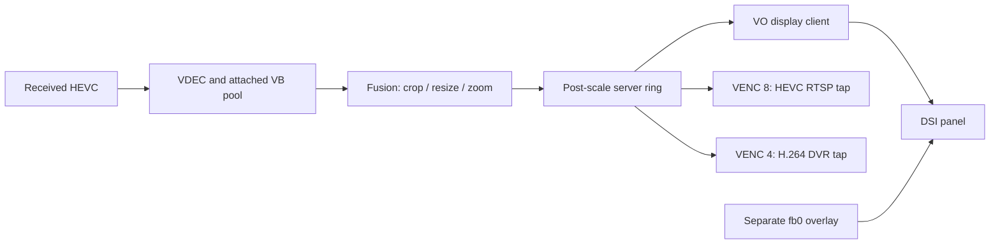

# VR04 reference stock media graph and MPP interfaces

[Systems](README.md) · [Reference board](../devices/betafpv-vr04-reference.md)

## Evidence boundary

This study consolidates the retained 1.0.44 goggle binary-analysis records for
`ar_lowdelay`, `libldrt_pipeline` and the MPI/HAL codec libraries, as recorded in
MissingLynk userspace revision `674ec00ecde0bba2eb844def1b4a0b7f8e685e13`.
Recovered offsets below are **reported static findings**, not a hardware-tested
replacement SDK. The original analysis contains incompatible frame-layout
interpretations; those remain unresolved here. No new hardware test was run.

The stock MPP interface, the later open V4L2 pipeline and the
[Gnd485 decoder-to-HDMI path](ar9311-display-pipeline.md) are separate systems.
Similar hardware does not establish identical buffer layouts or service ownership.

## Manually pumped decode, scale and display

The recovered pipeline imports no `AR_MPI_SYS_Bind`, `UnBind` or VPSS functions.
Threads explicitly receive, transform, enqueue and release frames. Attaching a
VB pool to VDEC is buffer ownership, not a SYS_Bind connection between stages.
The detailed VDEC call graph places the broadcast ring **after Fusion**; this
refines the earlier overview's ambiguous description of a pre-scale fan-out.

| Stage | Recovered flow |
| --- | --- |
| Decoder receive | `select(vdec_fd)` → `AR_MPI_VDEC_GetFrame` → status/query and enqueue |
| Fusion | Dequeue → `AR_MPI_SCALER_CropResize` → publish through `FusionServerSendBuffer` → release decoded frame |
| Display | `GetFrameByClientRx` → `PushFrameToDisplay` → `AR_MPI_VO_SendFrame` |
| Re-encode tap | Get a client frame → `AR_MPI_VENC_SendFrame` → release the client frame |

The explicit scaler is at `0x08840000`, exposed through `/dev/arscaler`.
Digital zoom uses the same crop/resize pass with an even-aligned crop rectangle.
VDEC emits the stream's coded dimensions; its configured maximum width/height
limit allocations and do not request upscaling. Resolution-change logging and
the absence of scaler calls inside the decoder support this division.

The record infers a fixed 1920×1080 Fusion destination from RTSP captures and
panel identification. The destination comes from a server attribute structure;
the exact constant was not isolated, and a known-720p input/output comparison
was proposed rather than performed. One note asserts VO does no further scaling;
another explicitly leaves its image-size/display-rectangle relationship open.
The explicit Fusion resize is supported; a universally verified 1:1 VO stage is not.

MPP initialization creates VPSS infrastructure even though the examined receive
pipeline does not use it. Missing imports in this path do not establish that
every process or capture path on the board avoids VPSS.

RTSP and DVR are re-encode consumers, not stages that video must traverse before
display. The hardware overlay is blended at scanout, so its pixels are not
automatically present in recording buffers. The video
[SEI/session data](../protocols/vr04-video-session.md) should also not be confused
with the separate flight-controller canvas protocol.

## Client frames and process ownership

The stock RTSP pump clears a **456-byte** outer frame object and gets a frame
with a 50 ms timeout. It passes **outer frame + 8** to VENC, with a 100 ms send
timeout, then releases the original client frame. The reconstructed client API
returns 0 for success, −1 for error and −2 for empty/timeout. Its opaque handle
indexes a client table; creation requires an initialized receive pipeline.
The stock caller supplies no meaningful name/id argument, but that does not
recover every caller's function signature.

Stock runs with `mpp_service=lib`. `ar_lowdelay` owns the in-process media service
and its CUSE devices, including VO, GE2D, control, queues and audio. It is not a
deployment with an independent `mpp_service.app` available to arbitrary clients.

The static trace of `AR_MPI_SYS_Init` claims the master role and enters service
initialization. Its guard is process-local. A second process therefore does not
inherit the first process's initialized session: it can repeat CUSE registration,
register mapping, clock/display and codec initialization. `SYS_Exit` also tears
down shared resources. Likewise, `VB_SetConfig` and `VB_Init` change the global
pool layout; a new channel number does not isolate those effects.

An in-process tap shares the existing session, as the stock RTSP pump does.
A sole-owner harness is a separate proposed arrangement, with the vendor media
stack absent. These observations do not establish a working independent codec
client alongside stock. The accepted channel index range **0–39** describes API
validation, not forty simultaneous hardware engines or guaranteed unused channels.
The older note's single-decoder assumption also predates the documented tiled
stream's second decode channel.

## Allocation and wire-size boundaries

MMZ allocation returns a physical address and CPU mapping. The recovered
`MmzAlloc`/`MmzAlloc_Cached` signature takes a `u64*` physical result, `void**`
mapping result, name, zone and `u32` length. Cached CPU writes need the appropriate
cache maintenance before DMA. Mapping memory and managing the codec session are
different operations; an allocator signature alone does not validate ownership
or coherency for a complete pipeline.

| VB structure or command | Recovered contract |
| --- | --- |
| Pool configuration | 40 bytes; `u64` block size at +0, `u32` count at +8 |
| Remaining pool fields | Remap mode at +12 and 24-byte zone name at +16 are inferred |
| Global configuration | 648 bytes; pool count at +0, sixteen 40-byte entries at +8 |
| Block handle | `(pool_id << 16) | block_index` |
| Create pool | `_IOW('b', 4, 40)` |
| Get block / handle to physical address | `_IOWR('b', 6, 64)` / `_IOWR('b', 9, 64)` |
| Set global configuration | `_IOW('b', 0, 648)` |

For example, a 1920×1088 4:2:0 allocation needs 3,133,440 bytes (`0x2fd000`).
That arithmetic does not recover a descriptor's plane offsets: visible height,
allocated height, row stride and plane extent remain distinct quantities.

## VDEC attributes and stream input

VDEC commands use `_IOWR('A', 15, 24)` on `/dev/vdecN`. The 24-byte envelope
contains a command-specific payload; it is not the size of every public structure.

| Attribute offset, decimal | Meaning in the 88-byte channel attribute |
| --- | --- |
| 0 | Payload: JPEG 26, H.264 96, H.265 265, MJPEG 1002 |
| 4 / 8 | VB source / stream-or-frame mode |
| 12 / 16 | Maximum allocation width / height |
| 20 | Compressed stream ring size; validation requires greater than `0x8000` |
| 24 / 28 | Frame-buffer size / count |
| 32 / 36 | Reference-frame count / temporal-MVP enable |
| 40 / 44 | Temporal-MV buffer size / command-queue depth |
| 48–87 | Unresolved codec union/reserved portion, not read by the examined create path |

Per-channel parameters occupy 52 bytes, query status 112, stream input 48,
frame get/release wire payloads 288, user data 48 and pool attachment 8.
The API additionally exposes stream start/stop, reset, parsed decoder information,
SEI retrieval/release, static user pictures, display order, rotation and module
parameters. Exported functions do not establish validation of every option.

In the 48-byte input descriptor, length is at +0, physical address at +8 and a
32-bit flag at +20. The flag exists; its interpretation as end-of-frame remains
inferred. A nonzero **unaligned 64-bit CPU pointer at +28** selects the MPI's
copy-to-ring path; a zero pointer leaves the physical feed path. PTS, end-of-stream
and display-flag offsets were not recovered. Error `0x80058403` appears in several
validation paths and is not a unique diagnosis of corrupt compressed video.

## Unresolved frame layout

The VDEC caller structure has writes through +444, whereas its wire payload is
288 bytes. The client ring adds an outer eight-byte prefix. These three objects
must not be treated as interchangeable just because all carry a frame.

| Field | VDEC GetFrame interpretation | VENC SendFrame packer interpretation |
| --- | --- | --- |
| Width / height / pixel format | +4 / +8 / +16 | +4 / +8 / +16 |
| Field/format-related value | +12, value 4 on H.264/H.265 paths | +24 |
| +48 / +52 / +56 | Plane dimensions in the VDEC analysis | +48 / +52 read as stride pair |
| Address triplet | +144 / +152 / +160, auxiliary +136 | +72 / +80 / +88 and +120 / +128 / +136; also a read at +240 |
| Strides | +356 / +360 / +364 | Mapping to those VDEC fields unestablished |

The outer-prefix adjustment does not reconcile all these differences. The
original suggestion to populate both sets of addresses is not a validated ABI
and is not a safe basis for a synthesized frame recipe. Its separate formula
placing the next plane only one row stride after the preceding plane is also
unresolved; plane extent must be established before such arithmetic is usable.

VDEC values 22/23 select half-height chroma paths, 24 a non-4:2:0 path and 60 a
fallback. The exact NV12/NV21 mapping is unknown. VENC accepts values
22/23/25/26/29/31 with different internal flags/codes; familiar SDK enum names
are insufficient evidence for assigning their layouts.

## VENC attributes, rate control and bitstream output

The channel attribute is 368 bytes (`0x170`): encoder attributes before `0x4c`,
rate-control mode at `0x4c`, its union at `0x50`, and GOP attributes at `0x68`.
Recovered offsets below are hexadecimal.

| Field | Offset / interpretation |
| --- | --- |
| Payload / pixel format | `0x00` / `0x04`; observed format 23 is not a fully recovered format name |
| Maximum width / height | `0x08` / `0x0c` |
| Buffer size / by-frame flag | `0x10` / `0x18` |
| Actual width / height | `0x1c` / `0x20` |
| CBR union | GOP `0x50`, statistics time `0x54`, source/destination fps `0x58`/`0x5c`, bitrate `0x60` |
| GOP policy | Mode `0x68`, Normal-P I/P delta `0x6c` |

The profile field at `0x14` has an unreliable enum description in the source:
it repeats the codec/rate-mode grouping. It is not reproduced as a recovered
profile enumeration. The stock caller clears only 336 of the 368 bytes; this
observation is not an initialization recipe for a new client.

The RC mode groups are H.264 1–6, MJPEG 7–9 and H.265 10–15. H.264/H.265 CBR
are 1/10, VBR 2/11, CVBR 5/14 and fixed-QP 6/15. The AVBR/QVBR ordering of the
remaining pairs was not resolved. The recovered static RC parameter stores
CU/HVS controls, first-frame QP, I/P/B QP bounds and QP-map policy. Min/max I-frame
proportion fields were stored and returned but no consuming path was identified.

The stock RTSP channel 8 uses HEVC CBR, 5000 kb/s, GOP 0, statistics time 30,
runtime frame rate near 60, Normal-P delta −2 and a QP floor of 0. That floor
must not be transferred to the air encoder, whose configuration reports 15.
HVS scale 4 in one public-structure reconstruction conflicts with 2 in the
open-parameter template and later open driver; the discrepancy remains open.
The DVR channel 4 uses a different MediaRecorder configuration path.

HAL payload sizes include SendFrame 152, GetStream 224, static RC parameters
1080, dynamic parameters 416, VUI 6780, JPEG parameters 200 and ROI 32 bytes.
The public GetStream object's pack pointer is at +0 and capacity/result count
at +8. Each **152-byte pack** has physical address +0, MPI-mapped CPU pointer
+8, length +16 and data type +44; PTS at +24 is inferred. ReleaseStream returns
ownership before the next acquisition. These caller packs are not the 224-byte
HAL GetStream payload.

## Later open recording path

The open pipeline uses V4L2 Wave5 H.264/H.265 with imported composite DMA-BUFs.
JPEG/MJPEG belong to different codec IP. Advertised generic dimensions up to
32768 do not establish silicon capability; retained validation is at 720p/1080p.
The enumerated 4:2:2 formats also do not establish a qualified end-to-end test
for every offered format.

Native 1080 recording imports the composite; 30 fps drops input frames.
720 recording uses a three-plane hardware scaler batch, reported around 6 ms per
frame on a recording worker. The 720p30 path gates frames before scaling. Pools
are allocated at startup because the recorded steady-state CMA free space was
too small for late allocation. With the scaler absent, the menu path logs a
fallback to native 1080; its old CPU-scaling experiment could enter PIC_RUN and
produce no bytes without an error.

File-fed 1080 tests at 38–42 fps included serialized CPU copies and do not bound
the codec's frame rate. The source retains an old “open 1080p60 not yet measured”
paragraph alongside later validation. The
[codec experiment record](../experiments/vr04-media-validation.md) preserves the
subsequent 480/480 concurrent workload and remaining encoder-reuse failures.
Its later media-pool accounting must not be combined with the earlier 64 MiB
CMA configuration as though they describe one memory map.
